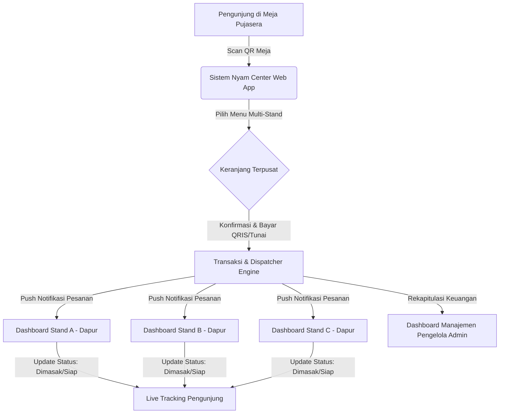

# 🍲 Sistem Informasi Pemesanan Makanan Nyam Center (Pujasera Multi-Tenant)

## 1. Identitas Dokumen & Tim Pengembang
Dokumen **Software Requirement Specification (SRS) & Architecture Blueprint** ini disusun untuk mendokumentasikan perancangan, analisis sistem, dan diagram arsitektur perangkat lunak pada platform **Nyam Center**.

### 👥 Anggota Tim Pengembang:
1. **Kristina Ina Helan** (NIM: 25091397085) — *System Architecture & UML (Sequence Diagram, Class Diagram)*
2. **Anisa Dini Septianda (ASA)** (NIM: 25091397092) — *Structured Analysis & Data Flow (DFD Level 0, DFD Level 1, DFD Level 2)*
3. **Riska Nuraini** (NIM: 25091397102) — *Data Modeling & Behavioral UML (ERD, Use Case Diagram, Activity Diagram)*

---

## 2. Gambaran Umum Sistem
**Nyam Center** adalah platform *web-based multi-tenant order management* yang dirancang khusus untuk Sentra Wisata Kuliner (SWK) dan pujasera. Platform ini mengatasi kendala antrean fisik, pesanan tertukar, dan rekap manual dengan mendigitalisasi seluruh rantai transaksi:

---

## 3. Fitur Utama Sistem
1. **Scan QR Meja Instan (Guest Ordering)**: Pengunjung dapat langsung mengakses katalog tanpa registrasi manual yang memberatkan.
2. **Katalog & Keranjang Multi-Stand Terpusat**: Kemampuan memesan menu dari beberapa stand UMKM berbeda dalam satu kali transaksi pembayaran.
3. **Multi-Payment Gateway**: Integrasi pembayaran instan via QRIS Dinamis, E-Wallet, VA Bank, serta opsi Tunai/COD.
4. **Multi-Tenant Kitchen Dispatcher**: Pembagian pesanan otomatis ke dashboard masing-masing stand secara terpisah dan *real-time*.
5. **Live Order Tracker & Struk Digital**: Pelacakan status sajian transparan dari "Diterima", "Sedang Dimasak", hingga "Siap Diambil/Diantar".
6. **Laporan & Rekapitulasi Finansial Pengelola**: Laporan omzet per stand, komisi pengelola, dan riwayat transaksi harian/bulanan.
