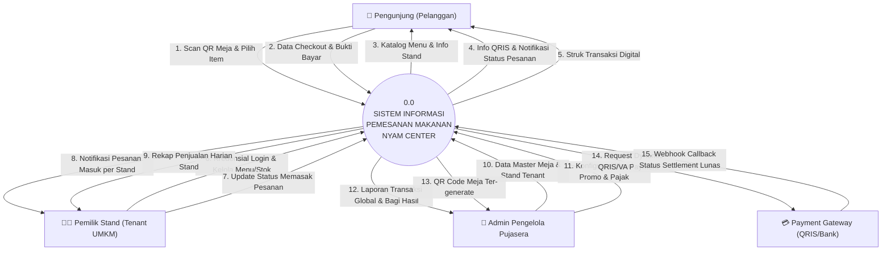
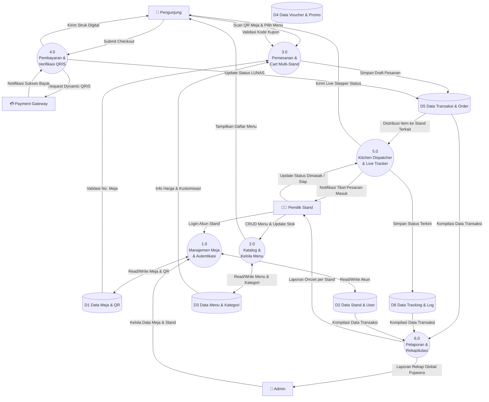
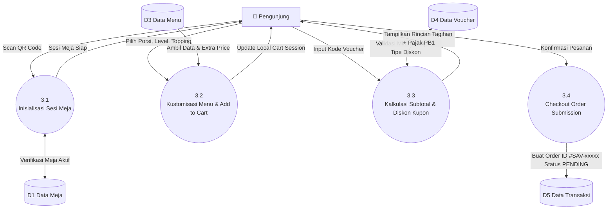
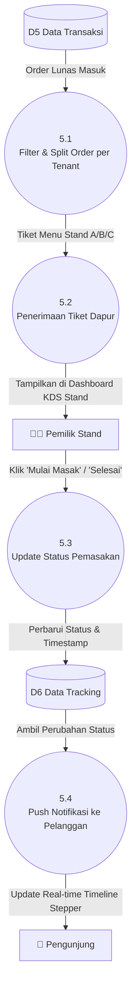

# 📊 Data Flow Diagram (DFD) — Anisa Dini Septianda (ASA)

**Disusun Oleh:** Anisa Dini Septianda (NIM: 25091397092)  
**Topik:** Pemodelan Aliran Data Terstruktur Sistem Pemesanan Makanan Nyam Center  

---

## 1. DFD Level 0 (Context Diagram)
Diagram Konteks menggambarkan batasan sistem secara menyeluruh dan interaksi antara **Sistem Informasi Nyam Center** dengan entitas eksternal: **Pengunjung**, **Pemilik Stand (Tenant)**, **Admin Pengelola**, dan **Payment Gateway**.

---

## 2. DFD Level 1 (Proses Utama Sistem)
DFD Level 1 memecah sistem utama menjadi 6 proses inti yang berinteraksi dengan 6 data store:

---

## 3. DFD Level 2 (Dekomposisi Proses Kunci)

### 3.1 DFD Level 2 — Proses 3.0 (Alur Pemesanan & Cart)

### 3.2 DFD Level 2 — Proses 5.0 (Kitchen Dispatcher & Live Tracking)

