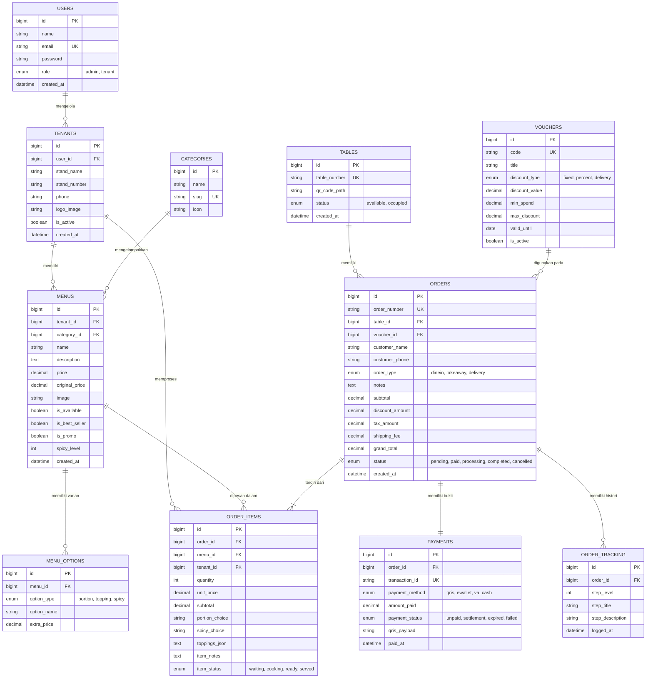
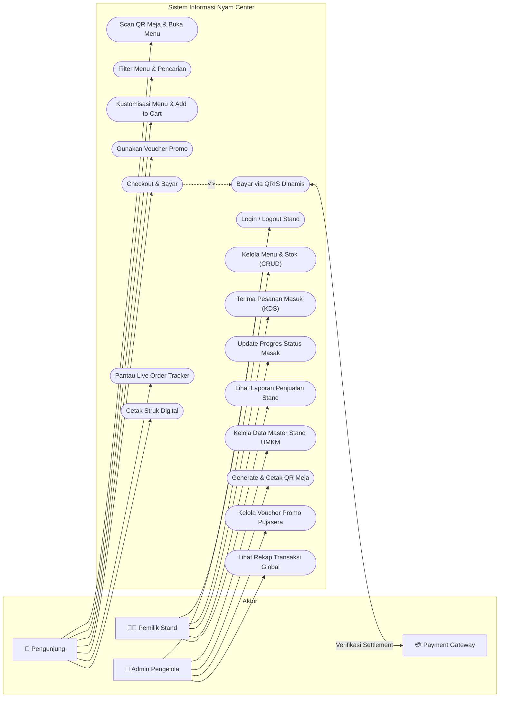
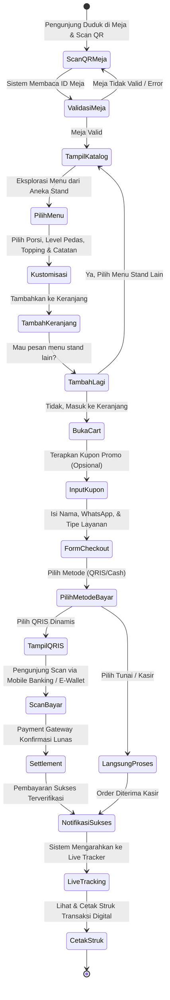
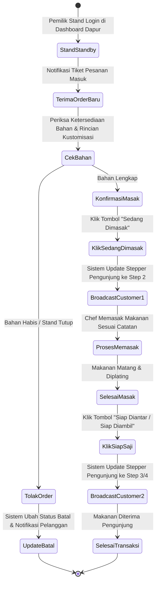

# 📐 Pemodelan Basis Data & UML — Riska Nuraini

**Disusun Oleh:** Riska Nuraini (NIM: 25091397102)  
**Topik:** Entity Relationship Diagram (ERD), Use Case Diagram, dan Activity Diagram  

---

## 1. Entity Relationship Diagram (ERD)
ERD memodelkan struktur data relasional pada sistem **Nyam Center** yang mendukung fitur *multi-tenant pujasera*.

---

## 2. Use Case Diagram
Use Case Diagram mendeskripsikan interaksi antara aktor (**Pengunjung**, **Pemilik Stand**, **Admin Pengelola**, dan **Payment Gateway**) dengan fungsionalitas sistem.

---

## 3. Activity Diagram

### 3.1 Activity Diagram: Alur Pemesanan & Pembayaran Pengunjung

### 3.2 Activity Diagram: Alur Pemrosesan Pesanan oleh Pemilik Stand (Dapur)

