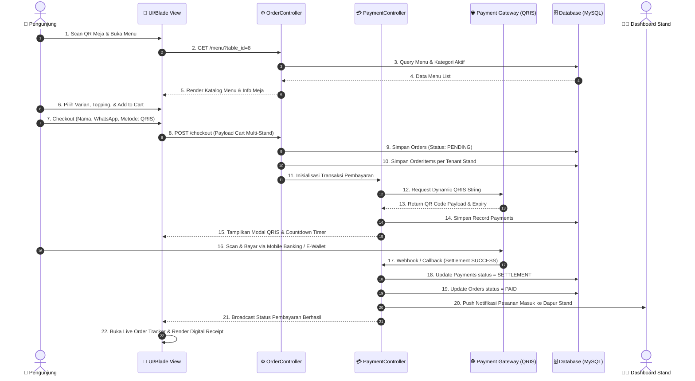
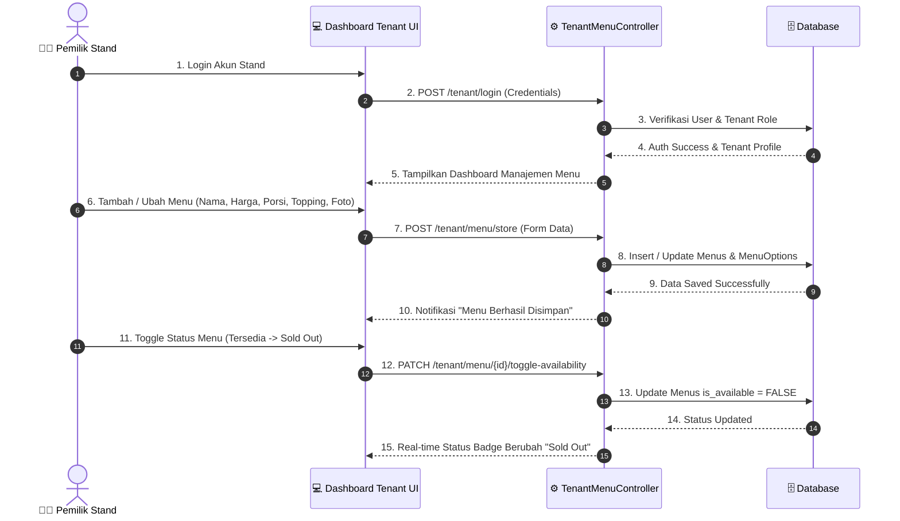
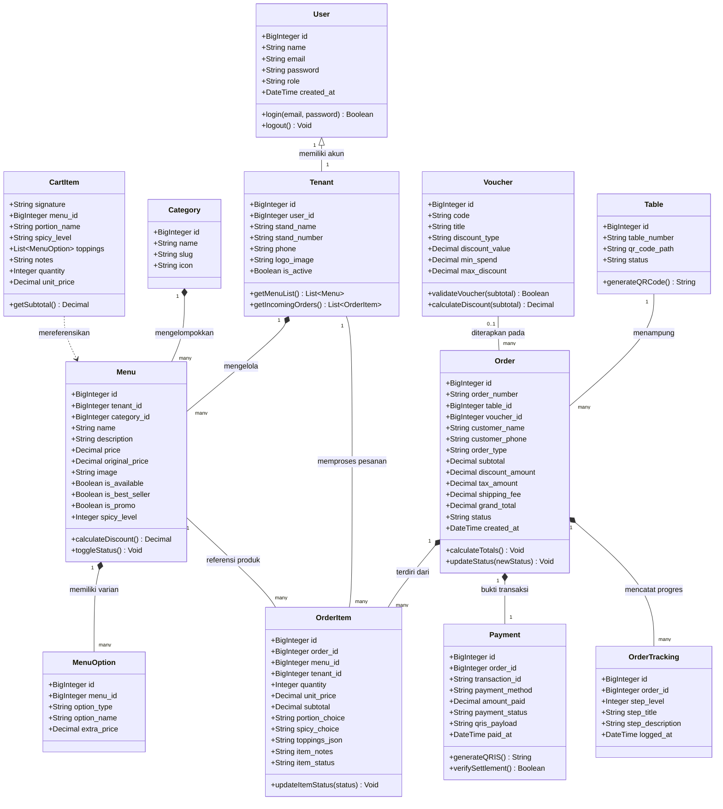

# 🏛️ Pemodelan Berorientasi Objek & UML — Kristina Ina Helan

**Disusun Oleh:** Kristina Ina Helan (NIM: 25091397085)  
**Topik:** Sequence Diagram dan Class Diagram Sistem Pemesanan Makanan Nyam Center  

---

## 1. Sequence Diagram

### 1.1 Sequence Diagram: Pemesanan Multi-Tenant & Pembayaran QRIS
Diagram ini memodelkan interaksi dinamis antara **Pengunjung**, antarmuka web (**UI Client**), controller aplikasi (**OrderController**, **PaymentController**), **Database**, dan **Payment Gateway**.

### 1.2 Sequence Diagram: Manajemen Menu & Stok oleh Pemilik Stand

---

## 2. Class Diagram
Class Diagram memodelkan struktur kelas logika berbasis konsep Object-Oriented Programming (OOP) dan arsitektur Model-View-Controller (MVC) di lingkungan Laravel.

