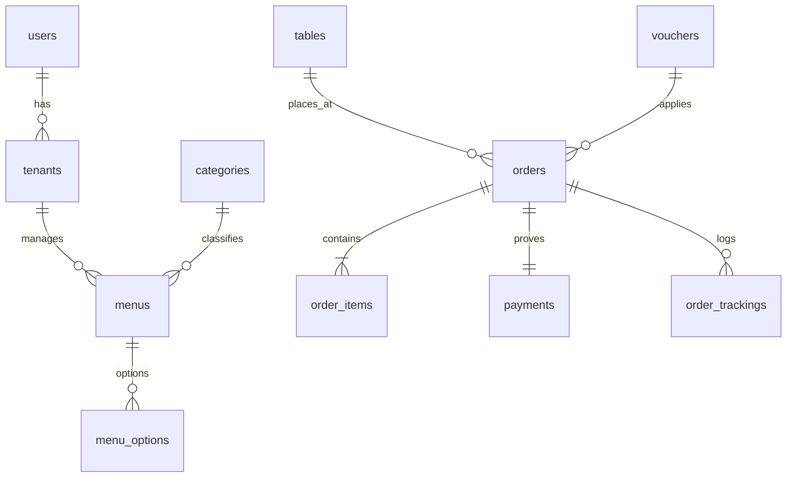

# 🗄️ Spesifikasi Skema Basis Data (Database Schema)

## 1. Konsep & Normalisasi Basis Data
Basis data **Nyam Center** dirancang memenuhi kaidah Third Normal Form (3NF) untuk mencegah redundansi dan anomali pembaruan pada lingkungan *multi-tenant*.

---

## 2. Definisi Kamus Data (Data Dictionary)

### 2.1 Tabel: `users`
| Field | Tipe Data | Nullable | Keterangan |
| :--- | :--- | :---: | :--- |
| `id` | BIGINT UNSIGNED AUTO_INCREMENT | No | Primary Key |
| `name` | VARCHAR(100) | No | Nama lengkap pengguna |
| `email` | VARCHAR(100) UNIQUE | No | Email akun untuk login |
| `password` | VARCHAR(255) | No | Password hash (Bcrypt) |
| `role` | ENUM('admin', 'tenant') | No | Hak akses sistem |
| `created_at` / `updated_at` | TIMESTAMP | Yes | Audit timestamps |

### 2.2 Tabel: `tenants`
| Field | Tipe Data | Nullable | Keterangan |
| :--- | :--- | :---: | :--- |
| `id` | BIGINT UNSIGNED AUTO_INCREMENT | No | Primary Key |
| `user_id` | BIGINT UNSIGNED | No | Foreign Key ke `users.id` |
| `stand_name` | VARCHAR(100) | No | Nama stand UMKM kuliner |
| `stand_number` | VARCHAR(20) | No | Nomor stand (e.g., 'Stand A-02') |
| `phone` | VARCHAR(20) | No | Nomor WhatsApp stand |
| `logo_image` | VARCHAR(255) | Yes | URL / path gambar logo |
| `is_active` | BOOLEAN | No | Status operasional stand |

### 2.3 Tabel: `tables` (Data Meja & QR)
| Field | Tipe Data | Nullable | Keterangan |
| :--- | :--- | :---: | :--- |
| `id` | BIGINT UNSIGNED AUTO_INCREMENT | No | Primary Key |
| `table_number` | VARCHAR(20) UNIQUE | No | Nomor meja (e.g., 'Meja 08') |
| `qr_code_path` | VARCHAR(255) | No | Path file QR code ter-generate |
| `status` | ENUM('available', 'occupied') | No | Status keterisian meja |

### 2.4 Tabel: `menus` & `menu_options`
| Field | Tipe Data | Nullable | Keterangan |
| :--- | :--- | :---: | :--- |
| `id` | BIGINT UNSIGNED AUTO_INCREMENT | No | Primary Key |
| `tenant_id` | BIGINT UNSIGNED | No | Foreign Key ke `tenants.id` |
| `category_id` | BIGINT UNSIGNED | No | Foreign Key ke `categories.id` |
| `name` | VARCHAR(150) | No | Nama menu makanan/minuman |
| `price` | DECIMAL(12,2) | No | Harga jual sekarang |
| `original_price` | DECIMAL(12,2) | Yes | Harga coret sebelum diskon |
| `is_available` | BOOLEAN | No | Status ketersediaan stok |
| `spicy_level` | TINYINT | No | Level pedas (0 - 5) |

### 2.5 Tabel: `orders` & `order_items`
| Field | Tipe Data | Nullable | Keterangan |
| :--- | :--- | :---: | :--- |
| `id` | BIGINT UNSIGNED AUTO_INCREMENT | No | Primary Key |
| `order_number` | VARCHAR(50) UNIQUE | No | Nomor order (e.g., 'SAV-88912') |
| `table_id` | BIGINT UNSIGNED | Yes | Foreign Key ke `tables.id` |
| `customer_name` | VARCHAR(100) | No | Nama pemesan |
| `customer_phone` | VARCHAR(20) | No | Nomor WhatsApp pemesan |
| `subtotal` | DECIMAL(12,2) | No | Total harga item sebelum diskon/pajak |
| `tax_amount` | DECIMAL(12,2) | No | Pajak PB1 (10%) |
| `grand_total` | DECIMAL(12,2) | No | Total tagihan akhir |
| `status` | ENUM('pending', 'paid', 'cooking', 'completed', 'cancelled') | No | Status pesanan |
