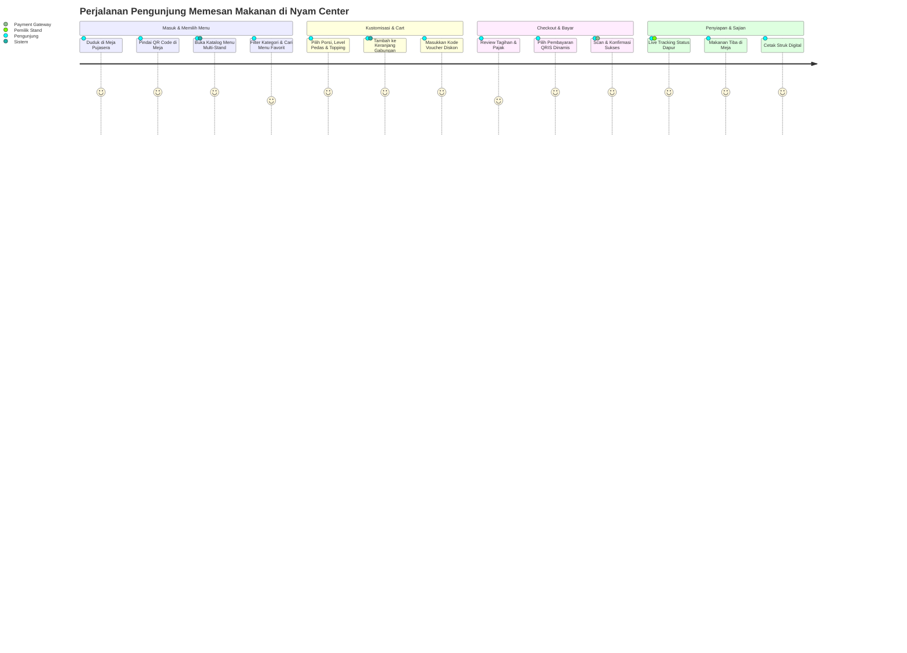

# 🎨 Desain Antarmuka & User Flow

## 1. User Journey Map (Pengunjung)

---

## 2. Struktur Desain UI (Design System Tokens)
- **Palette Warna**:
  - `Primary Accent`: Warm Amber `#f97316` & Coral `#fb7185` (Menstimulasi nafsu makan & kesan ramah).
  - `Background Dark Mode`: Deep Obsidian Navy `#090d16` & Surface `#111827`.
  - `Background Light Mode`: Crisp Clean Slate `#f8fafc` & White `#ffffff`.
- **Tipografi**: `Plus Jakarta Sans` dengan visual hierarchy yang tegas (H1 2.9rem, Title 1.45rem, Body 0.95rem).
- **Glassmorphism & Depth**: Backdrop filter blur 16px, border halus translucent, dan micro-shadow glow.
