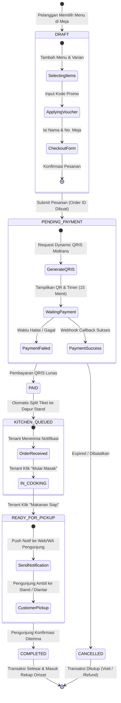

# 🔄 Diagram Status & Siklus Hidup Pesanan (State Machine Diagram)

**Disusun Untuk:** Dokumentasi Alur Transisi Status Pesanan Sistem Informasi Nyam Center  
**Tipe Diagram:** UML State Machine / State Chart Diagram  

---

## 1. Siklus Hidup Pesanan (Order Lifecycle State Diagram)

Diagram berikut memodelkan seluruh status transaksi pesanan dari saat pengunjung melakukan pemesanan hingga pesanan selesai dinikmati atau dibatalkan.

---

## 2. Tabel Transisi State & Aktor Pemicu

| State Awal | Event / Trigger | State Tujuan | Aktor Pemicu | Keterangan Sistem |
| :--- | :--- | :--- | :--- | :--- |
| **`DRAFT`** | Klik *Checkout* | `PENDING_PAYMENT` | Pengunjung | Order ID dibuat dengan nomor faktur `#SAV-xxxxx` |
| **`PENDING_PAYMENT`** | Scan QRIS & Transfer Berhasil | `PAID` | Payment Gateway | Webhook Midtrans/QRIS mengubah status menjadi Lunas |
| **`PENDING_PAYMENT`** | Timer 15 Menit Expired | `CANCELLED` | Cron System | Stok otomatis dikembalikan jika reservasi habis |
| **`PAID`** | Dispatcher Queue | `KITCHEN_QUEUED` | System Worker | Tiket pesanan otomatis didistribusikan ke KDS stand masing-masing |
| **`KITCHEN_QUEUED`** | Klik *"Mulai Masak"* | `IN_COOKING` | Pemilik Stand | Tracker pengunjung menampilkan estimasi waktu memasak |
| **`IN_COOKING`** | Klik *"Siap Saji"* | `READY_FOR_PICKUP` | Pemilik Stand | Notifikasi buzzer/popup muncul di gawai pengunjung |
| **`READY_FOR_PICKUP`** | Klik *"Selesai"* | `COMPLETED` | Pengunjung / Tenant | Transaksi tuntas, rating stand dapat diinput |
