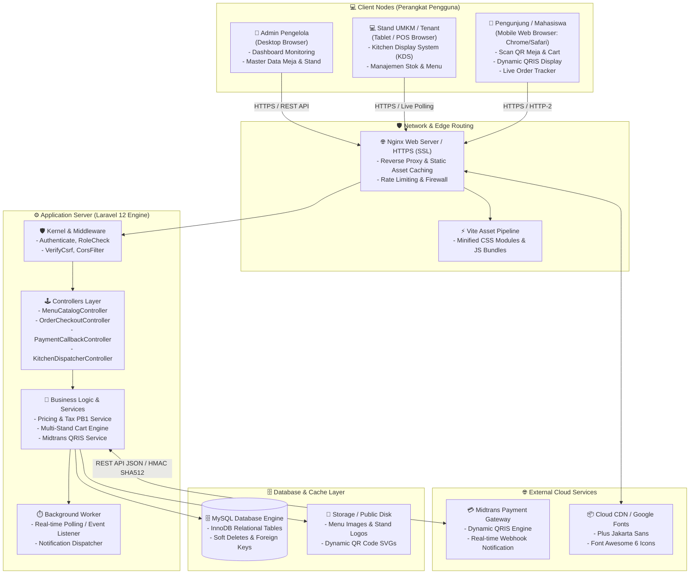

# 🏗️ Arsitektur Sistem & Deployment (Architecture & Deployment Diagram)

**Disusun Untuk:** Arsitektur Infrastruktur & Aliran Komponen Sistem Informasi Nyam Center  
**Tipe Diagram:** UML Deployment Diagram & Layered System Architecture  

---

## 1. Diagram Arsitektur Infrastruktur (Deployment Diagram)

Diagram berikut memodelkan bagaimana komponen perangkat lunak didistribusikan ke dalam node server, web browser pengguna, dan layanan pihak ketiga (Payment Gateway & CDN).

---

## 2. Arsitektur Berlapis (Layered MVC Architecture)

```mermaid
graph LR
    subgraph Presentation["🎨 Presentation Layer"]
        Blade["Blade Views (*.blade.php)"]
        CSSJS["Modular CSS & JS (Vite)"]
    end

    subgraph Control["⚙️ Controller & Route Layer"]
        WebRoute["Web Routes (routes/web.php)"]
        Controller["Laravel Controllers"]
    end

    subgraph Business["🧠 Domain & Service Layer"]
        CartService["Cart & Pricing Service"]
        PaymentService["Payment & Gateway Service"]
        TenantService["Tenant & Stock Service"]
    end

    subgraph DataAccess["🗄️ Data Access Layer"]
        Eloquent["Eloquent ORM Models"]
        DBMigration["Database Migrations & Seeders"]
    end

    Presentation --> Control
    Control --> Business
    Business --> DataAccess
```

