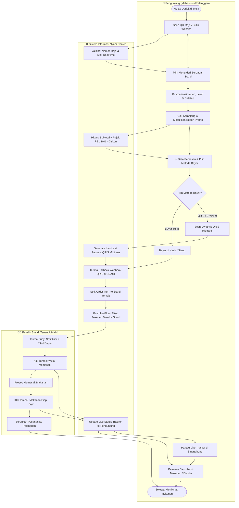

# 🧭 Alur Proses Bisnis & BPMN (End-to-End Business Process)

**Disusun Untuk:** Alur Proses Bisnis Terpadu Sistem Pemesanan Multi-Tenant Pujasera Nyam Center  
**Tipe Diagram:** Cross-Functional Flowchart (BPMN / Swimlane Process Map)  

---

## 1. Diagram Alur Proses Lintas Peran (Swimlane BPMN Diagram)

Diagram berikut memetakan perjalanan pesanan mulai dari pelanggan di meja makan, sistem aplikasi, dapur pemilik stand, hingga kasir/pembayaran terverifikasi.

---

## 2. Matriks Tanggung Jawab Operasional (RACI Matrix)

| Aktivitas Operasional | Pengunjung | Stand (Tenant) | Admin Pujasera | Sistem Otomatis |
| :--- | :---: | :---: | :---: | :---: |
| **Registrasi Stand Baru & Kelola Meja** | I | C | **A / R** | S |
| **Update Harga & Status Ketersediaan Stok** | I | **A / R** | C | S |
| **Pemilihan Menu & Multi-Cart Checkout** | **A / R** | I | I | S |
| **Verifikasi Pembayaran QRIS / Tunai** | R | I | C | **A / S** |
| **Penerimaan Tiket & Proses Memasak** | I | **A / R** | I | S |
| **Pengambilan / Pengantaran Makanan** | **R** | **R** | I | S |
| **Laporan Bagi Hasil & Rekap Omzet Harian** | I | R | **A** | **S** |

*Keterangan: **R** = Responsible, **A** = Accountable, **C** = Consulted, **I** = Informed, **S** = System Executed.*
