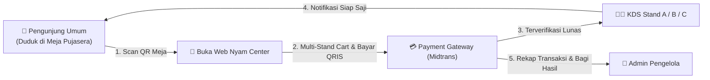

# 📚 Pusat Panduan Pengguna — Pujasera Nyam Center

Selamat datang di **Pusat Panduan Pengguna Sistem Informasi Pemesanan Makanan Pujasera Nyam Center**. Panduan ini dirancang untuk memandu seluruh pengguna aplikasi — mulai dari Pengunjung/Pelanggan umum, Pemilik Stand (Tenant UMKM), hingga Administrator Pengelola Pujasera — dalam memanfaatkan seluruh fitur sistem secara efektif.

---

## 🗺️ Peta Navigasi Panduan Pengguna

Pilihlah dokumen panduan atau halaman interaktif yang sesuai dengan peran Anda:

| Peran Pengguna | Deskripsi Fitur Utama | Dokumen Markdown | Halaman Interaktif |
| :--- | :--- | :--- | :--- |
| 🔐 **Semua Pengguna** | Autentikasi akun, Login, Lupa Password, Keamanan & Profil | [Panduan Autentikasi](./autentikasi.md) | [Buka Dokumentasi](../index.html) |
| 👤 **Pengunjung / Pelanggan** | Scan QR Meja, Pilih Menu Multi-Stand, Checkout QRIS & Tunai, Live Tracker Status | [Panduan Pengunjung](./pengunjung.md) | [Buka Pengunjung Guide](../pengunjung.html) |
| 👨‍🍳 **Tenant / Pemilik Stand** | Kitchen Display System (KDS), Kelola Menu & Porsi, Toggle Stok Habis, Rekap Omzet Stand | [Panduan Tenant](./tenant.md) | [Buka Tenant Guide](../tenant.html) |
| 🏢 **Administrator Pujasera** | Pengawasan Operasional, Kelola Stand & QR Meja, Atur Pajak PB1 & Voucher Promo | [Panduan Admin](./admin.md) | [Buka Admin Guide](../admin.html) |

---

## 🔄 Gambaran Umum Alur Operasional Pujasera Modern

