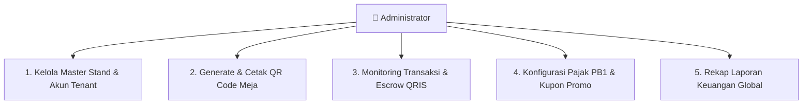

# 🏢 Panduan Administrator Pujasera — Nyam Center

**Target Pengguna:** Administrator & Pengelola Pujasera Nyam Center  
**Tujuan:** Panduan pengawasan operasional sentral, manajemen master data stand, kelola QR meja, biaya layanan/pajak, dan voucher promo.

---

## 1. Tanggung Jawab & Alur Kerja Administrator

---

## 2. Modul Operasional Administrator

### A. Manajemen Master Stand Tenant & Pengguna
1. **Registrasi Stand Baru:** Tambahkan nama stand, nomor stand di pujasera, logo, kontak penanggung jawab, dan hubungkan dengan akun pengguna yang ber-role *Tenant*.
2. **Kelola Akun & Hak Akses:** Tambah, edit, atau nonaktifkan akun pengguna yang bertugas di sistem.

### B. Manajemen Meja & Cetak QR Code
1. Masuk ke menu **Master Meja**.
2. Masukkan nomor atau label meja (misal: Meja 01 s.d Meja 50).
3. Klik tombol **Download QR Code** atau **Cetak Semua QR** untuk dicetak dalam bentuk stiker akrilik meja.

### C. Monitoring Transaksi & Rekap Keuangan
1. Pantau arus kas masuk dari Midtrans QRIS secara terpusat.
2. Hitung persentase bagi hasil pujasera (contoh: 5% fee manajemen operasional dan kebersihan).
3. Ekspor laporan harian/bulanan ke format Excel atau PDF.

### D. Pengaturan Pajak Restoran & Voucher
1. Atur persentase PB1 (Pajak Restoran) sesuai regulasi daerah.
2. Buat kode kupon promosi (*Voucher Code*) untuk mendongkrak omzet pujasera pada hari kerja atau jam tertentu.

### E. Prinsip Soft Delete & Pemulihan Data
- Seluruh data yang dihapus (Stand, Menu, Akun) dilindungi oleh fitur *Soft Delete* sehingga transaksi masa lalu tidak akan rusak/corrupt dan data dapat dipulihkan kapan saja.
