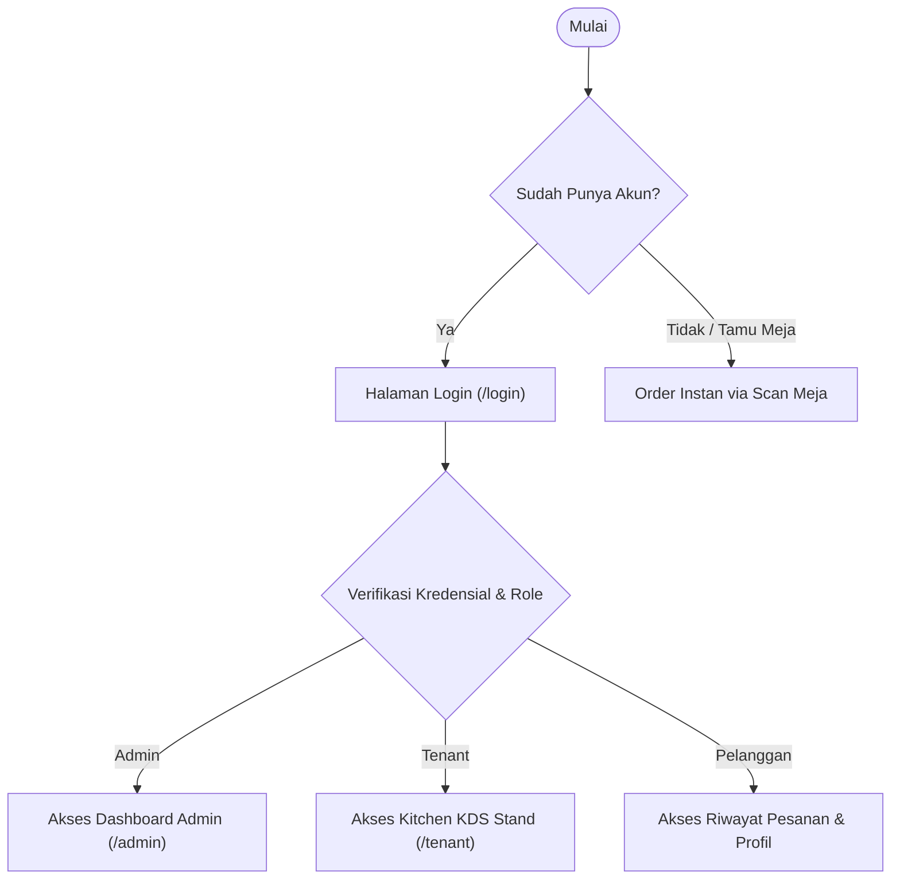

# 🔐 Panduan Autentikasi & Keamanan Pengguna

**Target Pengguna:** Seluruh Pengguna (Pengunjung, Pemilik Stand, Administrator)  
**Tujuan:** Panduan alur pendaftaran, login, pengelolaan sesi, dan hak akses peran.

---

## 1. Alur Masuk & Autentikasi

Sistem Informasi Nyam Center menyediakan dua metode pemesanan:
1. **Pengunjung Langsung (Guest Ordering):** Pengunjung yang datang ke pujasera cukup memindai QR code meja dan memasukkan nama serta nomor WhatsApp tanpa perlu membuat akun berbelit-belit.
2. **Pengguna Terdaftar (Registered User):** Pelanggan setia, Pemilik Stand (Tenant), dan Administrator dapat login menggunakan alamat email dan password terenkripsi (Bcrypt).

---

## 2. Hak Akses & Matriks Otorisasi (RBAC)

| Fitur / Menu | Guest / Pengunjung | Tenant (Pemilik Stand) | Administrator |
| :--- | :---: | :---: | :---: |
| **Scan QR Meja & Jelajah Menu** | ✅ | ✅ | ✅ |
| **Tambah ke Cart & Bayar QRIS** | ✅ | ❌ | ❌ |
| **Terima Tiket Dapur & Update Masak** | ❌ | ✅ | ✅ |
| **CRUD Menu, Harga & Stok Stand** | ❌ | ✅ (Hanya Stand Sendiri) | ✅ (Semua Stand) |
| **Registrasi Stand Baru & Generate QR** | ❌ | ❌ | ✅ |
| **Konfigurasi Diskon & Laporan Global** | ❌ | ❌ | ✅ |
