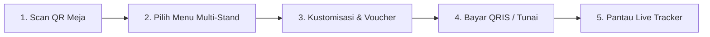

# 👤 Panduan Pengunjung & Pelanggan — Nyam Center

**Target Pengguna:** Pengunjung Umum Pujasera Nyam Center  
**Tujuan:** Panduan cara memesan makanan/minuman dari berbagai stand, checkout QRIS, dan melacak pesanan.

---

## 1. Alur Pemesanan Cepat Tanpa Antre

---

## 2. Langkah-Langkah Pemesanan

### Langkah 1: Scan QR Code di Meja
1. Duduk di salah satu meja yang tersedia di pujasera Nyam Center.
2. Buka kamera smartphone Anda atau aplikasi scanner QR.
3. Pindai stiker QR Code yang terpasang di meja.
4. Browser akan otomatis membuka katalog web Nyam Center dengan nomor meja yang terkunci.

### Langkah 2: Memilih Menu dari Berbagai Stand
- Anda dapat memilih makanan dan minuman dari **stand yang berbeda** sekaligus dalam satu keranjang belanja.
- Gunakan filter kategori (*Semua, Makanan Berat, Snack, Minuman, Promo*) atau cari nama hidangan pada kolom pencarian.

### Langkah 3: Kustomisasi Hidangan
- Klik tombol **"+ Tambah"** pada kartu menu.
- Pilih opsi varian porsi (*Reguler / Jumbo*), level kepedasan (*Level 0-5*), atau topping ekstra (*Telur, Keju, dll.*).
- Tuliskan catatan khusus untuk dapur (contoh: *"Jangan pakai daun bawang"*).

### Langkah 4: Checkout & Pembayaran
1. Buka keranjang belanja (*Drawer Cart*).
2. Masukkan kode voucher promo jika ada (contoh: `NYAMHEMAT`).
3. Isi **Nama Pemesan** dan **Nomor WhatsApp**.
4. Pilih metode pembayaran:
   - **QRIS Dinamis:** Scan kode QRIS yang muncul menggunakan BCA Mobile, GoPay, OVO, ShopeePay, DANA, dll. Pembayaran terverifikasi otomatis dalam 3 detik.
   - **Tunai di Kasir:** Datang ke kasir sentral atau stand dengan menunjukkan nomor invoice pesanan.

### Langkah 5: Live Order Tracker
Setelah pembayaran sukses:
- Layanan pelacak pesanan interaktif (*Live Stepper*) akan aktif.
- Anda akan melihat status pesanan: *Menunggu Konfirmasi ➔ Sedang Dimasak ➔ Makanan Siap Saji*.
- Ketika berstatus **"Siap Saji"**, Anda dapat mengambil hidangan ke stand terkait atau pelayan akan mengantarkannya ke meja Anda.
