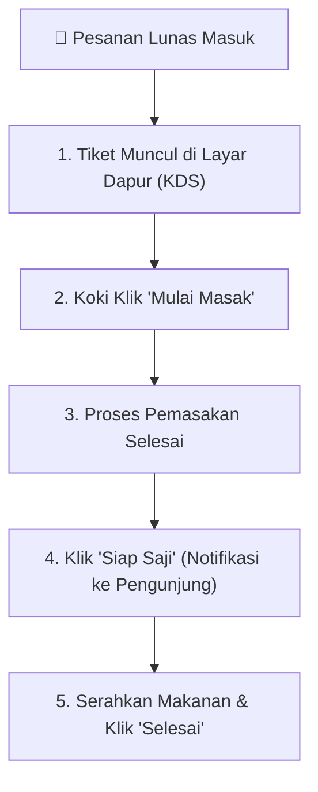

# 👨‍🍳 Panduan Pemilik Stand (Tenant UMKM) — Nyam Center

**Target Pengguna:** Pemilik & Koki Stand Pujasera Nyam Center  
**Tujuan:** Panduan operasional penerimaan pesanan dapur (KDS), pengelolaan menu & stok, dan laporan omzet harian.

---

## 1. Alur Kerja Dapur (Kitchen Workflow)

---

## 2. Fitur Utama Tenant

### A. Kitchen Display System (KDS)
1. Buka halaman dapur stand pada tablet atau smartphone.
2. Setiap pesanan baru yang dibayar oleh pengunjung akan memicu alarm bunyi dan kartu tiket pesanan berwarna kuning.
3. Kartu menampilkan: **Nomor Meja**, **Nama Pemesan**, **Daftar Menu**, **Pilihan Topping & Level Pedas**, serta **Catatan Dapur**.
4. Ubah status pesanan secara bertahap:
   - **Mulai Masak:** Mengubah timer dan memberi tahu pelanggan bahwa hidangan sedang diproses.
   - **Siap Saji:** Memicu notifikasi ke ponsel pengunjung untuk mengambil hidangan.

### B. Pengelolaan Menu & Stok Real-Time
1. Masuk ke menu **Katalog Menu Stand**.
2. **Tambah Menu Baru:** Isi nama menu, kategori, harga dasar, deskripsi, dan upload foto hidangan.
3. **Varian & Topping:** Atur opsi tambahan porsi atau ekstra keju/telur dengan biaya tambahan.
4. **Saklar Stok (Tersedia / Habis):** Jika stok bahan baku habis saat jam ramai, geser toggle status ke **Sold Out**. Menu akan langsung tertutup di halaman pemesanan pelanggan.

### C. Rekap Omzet Harian Stand
- Pantau total porsi terjual, menu terlaris (*Best Seller*), dan total pendapatan kotor maupun bersih harian setelah bagi hasil pujasera.
